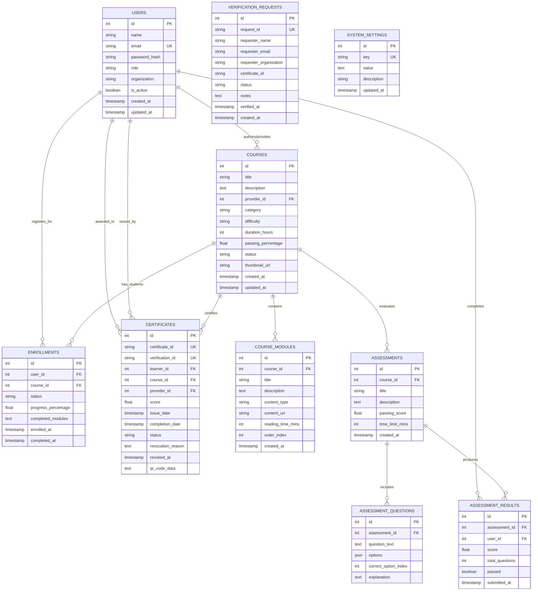

# Database Design & Relational Schema Specification

## 1. Relational Entity-Relationship (ER) Diagram

---

## 2. Table Specifications & Column Dictionaries

### 2.1 Table: `users`
Stores authenticated users belonging to the four platform roles (Admin, Course Provider, Learner, Verifier).

| Column Name | Data Type | Constraints | Description |
|:---|:---|:---|:---|
| `id` | INT | Primary Key, Auto Increment | Unique user identifier |
| `name` | VARCHAR(150) | NOT NULL | User's full legal name |
| `email` | VARCHAR(191) | NOT NULL, UNIQUE, INDEX | User login and contact email |
| `password_hash` | VARCHAR(255) | NOT NULL | 12-round salted bcrypt hash |
| `role` | VARCHAR(50) | NOT NULL, INDEX | One of: `admin`, `provider`, `learner`, `verifier` |
| `organization`| VARCHAR(200)| NULL | Associated university, academy, or company |
| `is_active` | BOOLEAN | NOT NULL, DEFAULT TRUE | Account state toggle (active/suspended) |
| `created_at` | TIMESTAMP | DEFAULT CURRENT_TIMESTAMP | Account registration timestamp |
| `updated_at` | TIMESTAMP | DEFAULT CURRENT_TIMESTAMP ON UPDATE | Last modification timestamp |

### 2.2 Table: `courses`
Stores certified curriculum information authored by course providers and approved by admins.

| Column Name | Data Type | Constraints | Description |
|:---|:---|:---|:---|
| `id` | INT | Primary Key, Auto Increment | Unique course identifier |
| `title` | VARCHAR(255) | NOT NULL | Full course title |
| `description` | TEXT | NULL | Course overview and learning outcomes |
| `provider_id` | INT | NOT NULL, FK -> `users(id)` | Authoring instructor / provider |
| `category` | VARCHAR(100)| NOT NULL, INDEX | E.g. "Cloud & DevOps", "Web Development" |
| `difficulty` | VARCHAR(50) | NOT NULL | "Beginner", "Intermediate", or "Advanced" |
| `duration_hours`| INT | NOT NULL, DEFAULT 10 | Estimated instructional hours |
| `passing_percentage`| FLOAT | NOT NULL, DEFAULT 70.0 | Minimum assessment score required to pass |
| `status` | VARCHAR(50) | NOT NULL, INDEX | `approved`, `pending`, or `rejected` |
| `thumbnail_url`| VARCHAR(500)| NULL | Public cover image link |
| `created_at` | TIMESTAMP | DEFAULT CURRENT_TIMESTAMP | Course creation timestamp |
| `updated_at` | TIMESTAMP | DEFAULT CURRENT_TIMESTAMP ON UPDATE | Last updated timestamp |

### 2.3 Table: `course_modules`
Contains individual instructional units, reading documents, videos, and practical exercises.

| Column Name | Data Type | Constraints | Description |
|:---|:---|:---|:---|
| `id` | INT | Primary Key, Auto Increment | Unique module identifier |
| `course_id` | INT | NOT NULL, FK -> `courses(id)` ON DELETE CASCADE | Associated parent course |
| `title` | VARCHAR(255) | NOT NULL | Module syllabus title |
| `description` | TEXT | NULL | Summary of lesson concepts |
| `content_type`| VARCHAR(50) | NOT NULL, DEFAULT 'document' | `document`, `video`, or `interactive` |
| `content_url` | VARCHAR(500)| NULL | Link to reading reference or video player |
| `reading_time_mins`| INT | NOT NULL, DEFAULT 15 | Estimated study duration |
| `order_index` | INT | NOT NULL, DEFAULT 1 | Display sequence order within syllabus |
| `created_at` | TIMESTAMP | DEFAULT CURRENT_TIMESTAMP | Timestamp added |

### 2.4 Table: `enrollments`
Tracks student course progress, completed module checklists, and completion timestamps.

| Column Name | Data Type | Constraints | Description |
|:---|:---|:---|:---|
| `id` | INT | Primary Key, Auto Increment | Unique enrollment ID |
| `user_id` | INT | NOT NULL, FK -> `users(id)` ON DELETE CASCADE | Enrolled student ID |
| `course_id` | INT | NOT NULL, FK -> `courses(id)` ON DELETE CASCADE | Course ID |
| `status` | VARCHAR(50) | NOT NULL, DEFAULT 'in_progress' | `in_progress` or `completed` |
| `progress_percentage`| FLOAT| NOT NULL, DEFAULT 0.0 | 0.0% to 100.0% dynamic completion |
| `completed_modules`| TEXT | NOT NULL, DEFAULT '[]' | JSON list of finished module IDs |
| `enrolled_at` | TIMESTAMP | DEFAULT CURRENT_TIMESTAMP | Registration date |
| `completed_at` | TIMESTAMP | NULL | Timestamp when 100% was reached |

### 2.5 Table: `assessments` & `assessment_questions`
Stores technical quizzes, questions, options, and explanations.

| Column Name | Data Type | Constraints | Description |
|:---|:---|:---|:---|
| `id` | INT | Primary Key, Auto Increment | Assessment ID |
| `course_id` | INT | NOT NULL, FK -> `courses(id)` ON DELETE CASCADE | Certified course |
| `title` | VARCHAR(255) | NOT NULL | Exam name |
| `description` | TEXT | NULL | Exam guidelines |
| `passing_score`| FLOAT | NOT NULL, DEFAULT 70.0 | Passing threshold |
| `time_limit_mins`| INT | NOT NULL, DEFAULT 30 | Countdown timer limit |

### 2.6 Table: `certificates`
The central registry ledger storing awarded credentials.

| Column Name | Data Type | Constraints | Description |
|:---|:---|:---|:---|
| `id` | INT | Primary Key, Auto Increment | Database record ID |
| `certificate_id`| VARCHAR(64) | NOT NULL, UNIQUE, INDEX | Formal ID (e.g. `CERT-2026-98124`) |
| `verification_id`| VARCHAR(64)| NOT NULL, UNIQUE, INDEX | Cryptographic Hash (e.g. `VFY-8A7B6C5D4E3F`) |
| `learner_id` | INT | NOT NULL, FK -> `users(id)` | Awarded student |
| `course_id` | INT | NOT NULL, FK -> `courses(id)` | Certified program |
| `provider_id` | INT | NOT NULL, FK -> `users(id)` | Issuing academy/instructor |
| `score` | FLOAT | NOT NULL, DEFAULT 100.0 | Exam grade percentage |
| `issue_date` | TIMESTAMP | DEFAULT CURRENT_TIMESTAMP | Date issued |
| `completion_date`| TIMESTAMP| DEFAULT CURRENT_TIMESTAMP | Date fulfilled |
| `status` | VARCHAR(50) | NOT NULL, DEFAULT 'valid', INDEX | `valid` or `revoked` |
| `revocation_reason`| TEXT | NULL | Reason for invalidation if revoked |
| `revoked_at` | TIMESTAMP | NULL | Invalidation timestamp |
| `qr_code_data` | TEXT | NULL | Encoded verification URL string |

### 2.7 Table: `verification_requests`
Maintains audit logs of employer background checks.

| Column Name | Data Type | Constraints | Description |
|:---|:---|:---|:---|
| `id` | INT | Primary Key, Auto Increment | Verification request record ID |
| `request_id` | VARCHAR(64) | NOT NULL, UNIQUE, INDEX | Formal Request ID (e.g. `VR-2026-0041`) |
| `requester_name`| VARCHAR(150)| NOT NULL | HR Director / Recruiter name |
| `requester_email`| VARCHAR(191)| NOT NULL | Corporate email |
| `requester_organization`| VARCHAR(200)| NULL | Hiring company name |
| `certificate_id`| VARCHAR(64) | NOT NULL, INDEX | Audited credential identifier |
| `status` | VARCHAR(50) | NOT NULL, DEFAULT 'verified' | `verified`, `pending`, `rejected` |
| `notes` | TEXT | NULL | Candidate audit notes |
| `verified_at` | TIMESTAMP | DEFAULT CURRENT_TIMESTAMP | Verification execution date |
| `created_at` | TIMESTAMP | DEFAULT CURRENT_TIMESTAMP | Inquiry created date |

